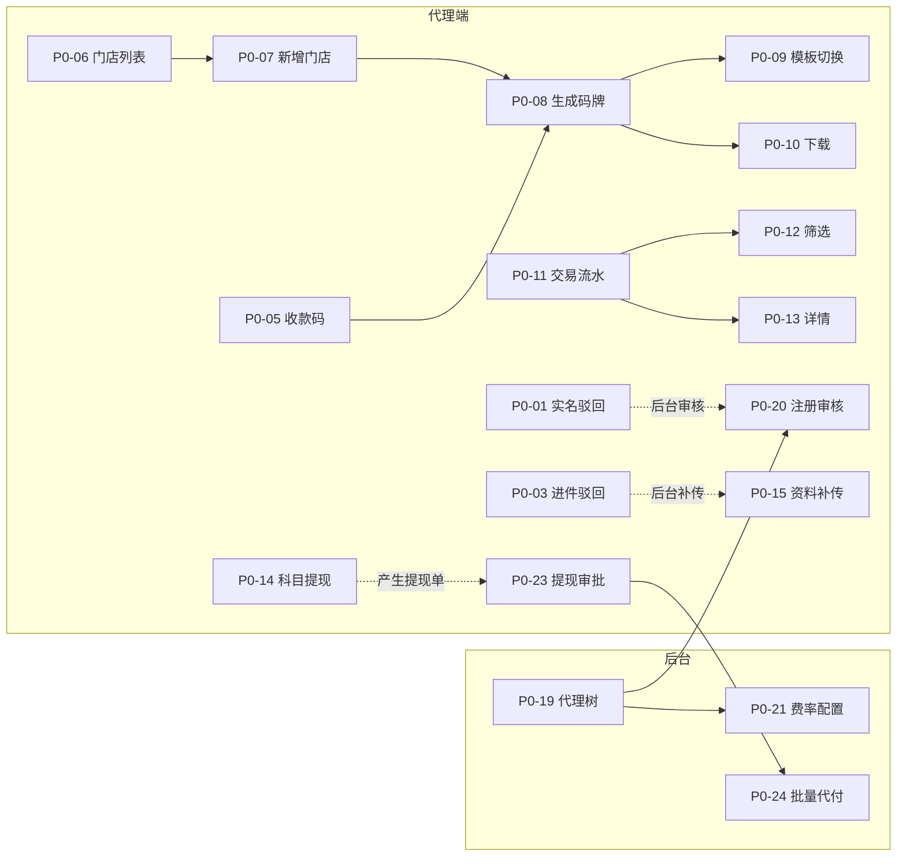
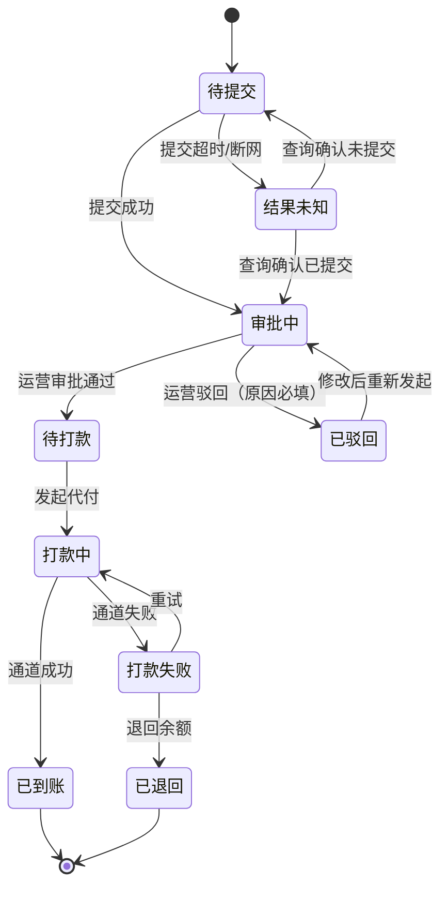

# P0 需求缺口拆解（P0-01～P0-25）

> **这是什么**：把 `docs/req-coverage.md` §4.1 的 24 个 P0 缺口（2026-11-11 晚增补 P0-25 后为 25 条），拆成可直接打勾的验收条目。给斯派克实现、铁扇公主验收用。
> **这不是什么**：不是需求原文，不改需求口径，不替斯派克定技术方案。与需求原文冲突时，以需求原文为准，并在 §6 记录裁决。

> **口径更新（2026-11-11 晚，队长裁决）**：新增 **P0-25「我的」模块**（MP-120～127），归属 **v0.3**。**P0 总数 24 → 25，v0.3 由 7 → 8**。本文中 24/7 的历史计数（§0.2、§8 等）**保留当时口径、不追溯改写**；现行口径以本条、§0.2 增补行、§1 的 P0-25 行与 §3 P0-25 为准。

| 项 | 值 |
|---|---|
| 基线 commit | `404d4b1`（`docs/req-coverage.md` / `design-spec.md` / `acceptance.md` 已齐） |
| 输入 | `docs/req-coverage.md` §4.1；`docs/design-spec.md` §5 / §6 / §7；`docs/acceptance.md` |
| 作者 | 张无忌（产品） |
| 日期 | 2026-11-11（初稿）；2026-11-11 回填队长裁决 |
| 归属口径 | 队长 2026-11-11 裁决：维持 24 个 P0；v0.2 17 个、v0.3 7 个 |
| 现行归属（2026-11-11 晚增补） | **25 个 P0**；v0.2 17 个、**v0.3 8 个**；新增 P0-25「我的」模块归 v0.3。上一行「归属口径」为增补前时点口径 |
| 裁决状态 | 7 条待确认已全部裁决并回填（§7）；AD-12 不升 P0 |
| 结论 | 24 个 P0 全部有编号、有入口、有判据；v0.2 关闭 17 个后，剩 7 个（**P0-02、P0-15、P0-16、P0-17、P0-18、P0-21、P0-22**）进 v0.3；另含 v0.2 附加项 MP-86（P1，不计入 24 条）。**2026-11-11 晚增补 P0-25，现行为 25 条 / v0.3 8 条，见 §8.1** |

## 0. 一页说明

### 0.1 目标用户与要解决的问题

| 项 | 内容 |
|---|---|
| 目标用户 | 一级/二级代理（代理端）、平台运营（后台） |
| 要解决的问题 | v0.1 的 17 屏只立住了「进件 → 商户 → 收益 → 提现」主干；门店、码牌、交易查询、代理树、提现审批等主链路断点仍缺，资金与合规关键操作没有可验收的界面 |
| 核心场景 | ① 代理被驳回后能改资料重提；② 代理给商户建门店、出门店码牌并下载；③ 代理查交易、看订单与分润明细；④ 运营在代理树里审核注册、调费率；⑤ 运营审批提现、批量代付并看到逐笔结果 |
| 本次交付 | 24 条 P0 的验收判据 + v0.2 附加项 MP-86 最小闭环验收（2026-11-11 晚增补 P0-25 后为 25 条）；不新增需求、不扩大范围 |
| 本期不做 | 真实通道/真实资金/真实回调；企业主体代理（§15.4 待确认）；增值收益提现（§15.2 #3 待确认）；海报展业、奖励引擎、码牌模板维护（二期）；退款记录与交易汇总（MP-63/64，P1）；公告、RBAC/报表（P1）；个人中心子页已由 2026-11-11 晚 **P0-25** 纳入 v0.3，不再列「本期不做」；码牌 PDF 印刷版（P2） |

### 0.2 归属结论

| 归属 | 数量 | 条目 |
|---|---:|---|
| v0.2 | 17 | P0-01、03、04、05、06、07、08、09、10、11、12、13、14、19、20、23、24 |
| v0.3 | 7 | P0-02、15、16、17、18、21、22 |
| **合计** | **24** | 代理端 14（v0.2 13 + v0.3 1）；后台 10（v0.2 4 + v0.3 6） |

> **2026-11-11 晚增补**：上表为增补前口径（24 条）。现行 **P0 = 25**、**v0.3 = 8**（上表 7 项 + P0-25）；代理端由 14 → 15，合计 25。上表数字保留原样，不追溯改写。

另：v0.2 附加项 **MP-86 提现单最小闭环**（P1，不计入 24 条）= 提交 → 生成提现单（审批中）→ 代理端记录可见 → 后台审批页可见 → 通过/驳回回写，见 §1.1。

### 0.3 编号说明（引用时必须带文档名）

- 本文的 `P0-01`～`P0-24` = **需求编号缺口**，与 `req-coverage.md` §4.1 一一对应。
- `design-spec.md` §13.1 也有一套 `P0-01`～`P0-12`，那是**实现缺陷**（对比度、浮点、死按钮等），与本文编号**同号不同义**。
- 引用时写「`p0-breakdown.md` P0-01」或「`design-spec.md` §13.1 P0-01」，不要只写 P0-01。2026-11-11 裁决：**暂不改编号**，引用时带文档名；`P0R-01` / `P0D-01` 的改名留到 v0.3 文档清理时再评估。

### 0.4 验收口径

1. 每条判据只能答「是 / 否」，不接受「基本可以」「体验还行」。
2. 一条 P0 下的判据**全部为「是」**才算该条关闭；任一条为「否」即未关闭，退回。
3. 每条 P0 至少覆盖：默认态 + 一个异常态。空态/加载/错误态按 `design-spec.md` §6 执行，本文只列与本条强相关的状态。
4. 证据：截图或录屏 + 操作路径；金额类附输入值与输出值。
5. 「演示数据」标注不得删除；不得接真实通道、不得产生真实资金动作。

## 1. 归属总表

| 编号 | 需求编号 | 功能 | 端 | 归属 | 依赖（P0 内） |
|---|---|---|---|---|---|
| P0-01 | MP-06 | 实名审核状态（审核中/通过/驳回重提） | 代理端 | v0.2 | P0-20 |
| P0-02 | MP-22 | 主体资料（证件/执照/省市定位） | 代理端 | v0.3 | — |
| P0-03 | MP-27 | 进件驳回重提（按通道） | 代理端 | v0.2 | P0-04 |
| P0-04 | MP-32 | 商户停用（二次确认+原因+回写） | 代理端 | v0.2 | — |
| P0-05 | MP-33 | 收款码查看（进码牌页并带商户） | 代理端 | v0.2 | P0-08 |
| P0-06 | MP-40 | 门店列表 | 代理端 | v0.2 | — |
| P0-07 | MP-41 | 新增/编辑门店 | 代理端 | v0.2 | P0-06 |
| P0-08 | MP-50 | 生成码牌（选商户/门店） | 代理端 | v0.2 | P0-06、P0-07 |
| P0-09 | MP-51 | 模板切换 | 代理端 | v0.2 | P0-08 |
| P0-10 | MP-52 | 下载（PNG/相册） | 代理端 | v0.2 | P0-08 |
| P0-11 | MP-60 | 交易流水 | 代理端 | v0.2 | — |
| P0-12 | MP-61 | 交易筛选 | 代理端 | v0.2 | P0-11 |
| P0-13 | MP-62 | 交易详情 | 代理端 | v0.2 | P0-11 |
| P0-14 | MP-80 | 选择科目提现（六科目） | 代理端 | v0.2 | — |
| P0-15 | AD-03 | 资料补传 | 后台 | v0.3 | P0-03 |
| P0-16 | AD-04 | 费率调整（单商户覆盖+留痕） | 后台 | v0.3 | — |
| P0-17 | AD-05 | 停用/冻结（含门店级） | 后台 | v0.3 | P0-04 |
| P0-18 | AD-07 | 存量商户批量导入 | 后台 | v0.3 | — |
| P0-19 | AD-10 | 代理树 | 后台 | v0.2 | — |
| P0-20 | AD-11 | 注册审核 | 后台 | v0.2 | P0-19 |
| P0-21 | AD-13 | 费率配置（成本价/对外报价） | 后台 | v0.3 | P0-19 |
| P0-22 | AD-32 | 分润明细 | 后台 | v0.3 | — |
| P0-23 | AD-50 | 提现审批 | 后台 | v0.2 | P0-14 |
| P0-24 | AD-51 | 批量代付 | 后台 | v0.2 | P0-23 |
| P0-25 | MP-120～127 | 「我的」模块（个人资料/钱包/结算卡/政策/推荐码/服务中心/退出） | 代理端 | v0.3 | — |

> **2026-11-11 晚增补**：上表新增 P0-25 一行（v0.3，2026-11-11 晚队长裁决）；其余 24 行与依赖图不变。

### 1.1 v0.2 附加项（P1，不计入 24 个 P0）

| 编号 | 事项 | 性质 | 作用 | 验收（是/否） |
|---|---|---|---|---|
| MP-86 | 提现单最小闭环 | P1，v0.2 附加项，**不占 P0 编号、不计入 24 条** | 为 P0-23 提供真实「审批中」数据；没有它，审批页只能用假数据 | 提交后生成提现单并显示「审批中」；代理端提现记录可见；后台 `#p-withdrawals` 可见同一笔；后台通过/驳回后状态回写代理端 |

裁决（2026-11-11）：**做**。链路 = 提交 → 生成提现单（审批中）→ 代理端记录可见 → 后台审批页可见 → 通过/驳回回写；批量代付演示到「已代付」，不接真实资金。MP-86 的判据并入 P0-23 验收，不单独计 P0。

## 2. 依赖关系

**关键依赖说明**

- **P0-06/07 是 P0-08 的前置**：没有门店，码牌页无法满足「必须选门店」的验收。
- **P0-14 是 P0-23 的数据来源**：代理端提交提现后要有「审批中」的提现单，后台审批页才有真实数据可审。
- **P0-20 是 P0-01 的对端**：后台能审核/驳回，代理端才能演示「驳回 + 原因 + 重提」。
- **P0-03 与 P0-15 成对**：代理端重提、后台补传是同一异常流的两端；P0-15 在 v0.3，不阻塞 P0-03 验收，但 v0.3 必须补。

## 3. 逐条拆解

> 每条固定 7 个字段：需求编号 / 端 / 入口 / 操作步骤 / 判据（是/否）/ 归属 / 依赖。另加「异常与边界」「不通过示例」帮助测试定位。

---

### P0-01 实名审核状态（MP-06）

| 项 | 内容 |
|---|---|
| 端 | 代理端 |
| 归属 | v0.2 |
| 入口 | 注册提交后进入 `#m-pending`；已驳回账号登录/刷新直接落到该页驳回态 |
| 依赖 | MP-03/04 注册表单；**P0-20** 后台注册审核；演示用「模拟审核通过 / 模拟驳回」按钮（标注「演示用，生产删除」） |
| 操作步骤 | 1. 注册提交 → 审核中页；2. 点「刷新状态」（或演示按钮）触发通过/驳回；3. 通过 → 自动进首页；4. 驳回 → 看原因 → 点「重新提交资料」；5. 表单预填、只改驳回项 → 重新提交 → 回审核中 |
| 异常与边界 | 审核超 1 个工作日 → 「审核时间超出预期」+ 客服，不自动通过；刷新失败保留上次状态，不假装通过；提交按钮 loading，防重复 |
| 不通过示例 | v0.1 只有「审核中」，驳回后无出口 |

**判据（全部为「是」才算通过）**

- [ ] ① 审核中页显示预计审核时长（1 个工作日）与三步时间线。
- [ ] ② 驳回态显示红色图标 + 至少 1 条具体驳回原因，且原因可逐条对应到资料项。
- [ ] ③ 驳回态有「重新提交资料」主按钮，点击进入预填表单。
- [ ] ④ 重提表单中非驳回项为只读或不可修改，驳回项可修改。
- [ ] ⑤ 重新提交成功后回到「审核中」，时间线新增一条提交记录。
- [ ] ⑥ 演示「审核通过」后 3 秒内进入首页，业务宫格由锁定变为可用。
- [ ] ⑦ 账号停用态显示「审核已终止」+ 原因，且不显示提交入口。

---

### P0-02 主体资料（MP-22）

| 项 | 内容 |
|---|---|
| 端 | 代理端 |
| 归属 | v0.3 |
| 入口 | `#m-mchnew` 主体资料区 |
| 依赖 | MP-20 商户类型；MP-21 通道选择；MP-23 结算账户 |
| 操作步骤 | 1. 选个人小微 / 个体工商户；2. 填手机号、商户名、经营类目；3. 选省/市/区 + 详细地址 + 定位；4. 上传门头照、身份证人像面/国徽面、银行卡正面照；5. 个体户额外上传营业执照；6. 提交 |
| 异常与边界 | 图片格式/大小超限拦截；上传中断可重试且其他字段保留；身份证有效期早于今天拦截；定位失败允许手填地址；证件照与姓名不匹配提示 |
| 不通过示例 | v0.1 只有手机号、名称、地址、类目、门头照 |

**判据**

- [ ] ① 个人小微的上传项包含身份证人像面、身份证国徽面、银行卡正面照、门头照，缺一不可提交。
- [ ] ② 选「个体工商户」时额外出现营业执照上传位，且为必填。
- [ ] ③ 经营地址包含省/市/区三级选择 + 详细地址 + 定位，三者为必填。
- [ ] ④ 缺任一必填项点提交，被拦截并定位到第一个缺失字段（字段级红字）。
- [ ] ⑤ 身份证有效期早于今天时，提交被拦截并提示「身份证已过期」。
- [ ] ⑥ 任一图片上传失败时，该位置显示「上传失败，点击重试」，其他已填内容不丢失。

---

### P0-03 进件驳回重提（MP-27）

| 项 | 内容 |
|---|---|
| 端 | 代理端 |
| 归属 | v0.2 |
| 入口 | 商户列表「已驳回」tab → 商户卡「去重提」；商户详情驳回卡「重新提交」 |
| 依赖 | MP-26 三态看板；P0-04 商户详情；P0-15（v0.3）后台补传 |
| 操作步骤 | 1. 商户列表切「已驳回」；2. 进详情看逐通道驳回原因；3. 点「重新提交资料」；4. 表单预填，只改被驳回通道的资料；5. 提交 → 回三态看板 |
| 异常与边界 | 多通道同时驳回 → 分别重提、互不影响；重提时通道已暂停 → 阻断并提示换通道；重提结果未知 → 显示「确认中」不显示成功；提交按钮 loading |
| 不通过示例 | v0.1 无驳回态、无原因、无重提入口 |

**判据**

- [ ] ① 驳回态按通道展示驳回原因，至少一条原因能落到具体资料项。
- [ ] ② 只重提被驳回的通道，其他通道的三态与时间不变。
- [ ] ③ 重提表单预填原资料，非驳回项不可改。
- [ ] ④ 重提成功后该通道回到「进件中」或「报备中」，时间线新增一条记录。
- [ ] ⑤ 提交按钮在请求中为 loading + disabled，连续点击只产生 1 次提交。
- [ ] ⑥ 重提结果未知时显示「结果确认中」，提供查询入口，不显示「已提交成功」。

---

### P0-04 商户停用（MP-32）

| 项 | 内容 |
|---|---|
| 端 | 代理端 |
| 归属 | v0.2 |
| 入口 | `#m-mchdetail` 底部「停用商户」 |
| 依赖 | 商户详情；列表状态回写 |
| 操作步骤 | 1. 进商户详情；2. 点「停用商户」；3. 二次确认弹窗填原因；4. 确认；5. 回详情/列表看状态 |
| 异常与边界 | 取消不改状态；原因必填 **2–50 字**（前后端一致，少于 2 字或超过 50 字给提示）；停用失败保留原状态并提示；重复点击只提交一次；停用后存量交易与分润照常结算（文案要写明） |
| 不通过示例 | v0.1 按钮自跳本页，无确认、无原因、无回写 |

**判据**

- [ ] ① 点「停用商户」先弹二次确认，不直接执行。
- [ ] ② 原因少于 2 字或超过 50 字时「确认停用」不可点，并有字段级提示（2–50 字口径）。
- [ ] ③ 确认后详情头卡状态变为「已停用」，返回列表该行同步为「已停用」。
- [ ] ④ 停用后详情不再显示「停用商户」，改为「联系上级」；页面出现停用原因、操作人、时间。
- [ ] ⑤ 停用后页面明确显示「存量交易与分润照常结算，不再产生新交易」。
- [ ] ⑥ 点「取消」后状态与页面均不变。

---

### P0-05 收款码查看（MP-33）

| 项 | 内容 |
|---|---|
| 端 | 代理端 |
| 归属 | v0.2 |
| 入口 | 商户详情「查看收款码」；首页「终端管理」 |
| 依赖 | **P0-08** 码牌出图页 `#m-qr` |
| 操作步骤 | 1. 进商户详情；2. 点「查看收款码」；3. 带商户进入 `#m-qr`；4. 看到该商户的码牌预览 |
| 异常与边界 | 带参失败时回落为手动选商户，不白屏；商户未完成报备/已停用时不可出码并说明原因 |
| 不通过示例 | v0.1 按钮 `data-go` 指向本页，点了没反应 |

**判据**

- [ ] ① 点「查看收款码」进入 `#m-qr`，不再停留在商户详情。
- [ ] ② 进入后商户已自动带入并显示商户名，不需要重新选。
- [ ] ③ 首页「终端管理」进入同一页面，未带商户时显示「请选择商户」。
- [ ] ④ 商户未完成报备或已停用时，出码区置灰并显示具体原因。
- [ ] ⑤ 从码牌页返回时回到进入前的页面（详情或首页），不是固定跳某一页。

---

### P0-06 门店列表（MP-40）

| 项 | 内容 |
|---|---|
| 端 | 代理端 |
| 归属 | v0.2 |
| 入口 | 商户详情「门店数」行 → `#m-stores`（首页 4×2 宫格不加第 9 格；2026-11-11 已裁决） |
| 依赖 | 商户详情；P0-07 新增/编辑 |
| 操作步骤 | 1. 商户详情点门店数；2. 看门店列表（门店名/地址/状态/关联商户）；3. 搜索；4. 点行进入编辑；5. 点「新增门店」 |
| 异常与边界 | 加载失败可重试；空态给「新增门店」；搜索无结果给「清除筛选」；单店停用不影响同商户其他门店 |
| 不通过示例 | v0.1 无门店模块 |

**判据**

- [ ] ① 门店列表每行显示门店名、地址、状态、所属商户。
- [ ] ② 无门店时显示空态「还没有门店」+「新增门店」按钮，点击可进新增。
- [ ] ③ 搜索框输入关键词后列表按名称过滤，不是只换高亮。
- [ ] ④ 搜索无结果时显示「没有找到匹配的门店」+「清除筛选」。
- [ ] ⑤ 门店状态至少区分「正常 / 已停用」，停用行有明确标识且不可出码。

---

### P0-07 新增/编辑门店（MP-41）

| 项 | 内容 |
|---|---|
| 端 | 代理端 |
| 归属 | v0.2 |
| 入口 | 门店列表「新增门店」；门店行「编辑」 |
| 依赖 | **P0-06** 门店列表 |
| 操作步骤 | 1. 新增 → 填门店名、地址、联系人、电话；2. 保存；3. 回列表看到新行；4. 点行编辑 → 改地址 → 保存 → 列表同步 |
| 异常与边界 | 门店名/地址必填；同商户下门店名重复拦截；保存失败保留输入；停用门店需二次确认（MP-42，P1） |
| 不通过示例 | v0.1 无门店模块 |

**判据**

- [ ] ① 门店名、地址为空时「保存」不可用，或有字段级错误提示。
- [ ] ② 保存成功后列表新增 1 行，无需手动刷新。
- [ ] ③ 编辑时表单预填原值，保存后列表对应行同步更新。
- [ ] ④ 同一商户下新增重名门店被拦截，并提示「该门店已存在」。
- [ ] ⑤ 保存请求中按钮 loading，连续点击只产生 1 条门店。

---

### P0-08 生成码牌（MP-50）

| 项 | 内容 |
|---|---|
| 端 | 代理端 |
| 归属 | v0.2 |
| 入口 | 首页「终端管理」；商户详情「查看收款码」→ `#m-qr` |
| 依赖 | **P0-06、P0-07** 门店；MP-20/21 商户与通道 |
| 操作步骤 | 1. 选商户；2. 选门店（必选）；3. 选模板；4. 看预览；5. 点生成/保存 |
| 异常与边界 | 未选门店不可生成；驳回/停用商户或门店置灰并说明；无商户空态「去新增商户」；无模板空态「联系运营」；生成失败保留选择可重试 |
| 不通过示例 | v0.1 无码牌页 |

**判据**

- [ ] ① 未选门店时生成/保存按钮禁用，并有「请选择门店」提示。
- [ ] ② 商户或门店为驳回/停用状态时不可选中，且显示具体原因。
- [ ] ③ 预览区显示商户名、二维码、支付方式图标和「演示码」水印。
- [ ] ④ 二维码静区不小于 4 个模块，预览中不拉伸、不裁切。
- [ ] ⑤ 生成中按钮为 loading，预览区为骨架；失败后保留已选商户/门店/模板，可重新生成。
- [ ] ⑥ 生成记录列表能显示时间、商户、模板，并可再次生成。

---

### P0-09 模板切换（MP-51）

| 项 | 内容 |
|---|---|
| 端 | 代理端 |
| 归属 | v0.2 |
| 入口 | `#m-qr` 模板横滑区 |
| 依赖 | **P0-08** 生成码牌 |
| 操作步骤 | 1. 在码牌页横滑模板；2. 切立牌 / 桌贴 / 贴纸；3. 看预览比例与尺寸变化 |
| 异常与边界 | 无模板时显示空态并联系运营；v0.2 **固定 3 个模板**（立牌/桌贴/贴纸），不提供后台增删改；页面注明「模板由后台配置」（AD-80～82 二期再接） |
| 不通过示例 | v0.1 无模板选择 |

**判据**

- [ ] ① 页面提供且仅提供「立牌 / 桌贴 / 贴纸」3 个模板，均可切换（v0.2 固定 3 个）。
- [ ] ② 切换后预览比例分别为 3:4 / 1:1 / 1:1，二维码不变形。
- [ ] ③ 选中模板有 1.5px 边框 + 勾选标识。
- [ ] ④ 每个模板显示模板名与成品尺寸（105×148mm / 90mm 圆 / 70×70mm）。
- [ ] ⑤ 页面注明「模板由后台配置」，不出现模板增删改入口。

---

### P0-10 下载（MP-52）

| 项 | 内容 |
|---|---|
| 端 | 代理端 |
| 归属 | v0.2 |
| 入口 | `#m-qr` 操作区 |
| 依赖 | **P0-08** 生成码牌 |
| 操作步骤 | 1. 生成预览后点「保存到相册」或「下载 PNG」；2. 看成功/失败反馈；3. 在生成记录里再次下载 |
| 异常与边界 | 相册权限拒绝 → 「去设置」+「下载 PNG」备选，不假装成功；原型环境不能写相册 → 提示「演示环境请使用下载 PNG」；下载失败可重试；生成中重复点击只触发一次 |
| 不通过示例 | v0.1 无下载动作 |

**判据**

- [ ] ① 点「下载 PNG」后出现成功 toast，或浏览器真实触发下载。
- [ ] ② 下载文件名符合 `码牌_商户名_模板_YYYYMMDD.png`。
- [ ] ③ 相册权限被拒绝时，弹窗提供「去设置」和「下载 PNG」两个出口。
- [ ] ④ 原型环境无法写相册时，提示「演示环境请使用下载 PNG」，不显示「已保存到相册」。
- [ ] ⑤ 下载失败时保留当前预览与选择，并提供「重试」。
- [ ] ⑥ 生成记录中的「下载」能再次触发下载，且文件名规则一致。

---

### P0-11 交易流水（MP-60）

| 项 | 内容 |
|---|---|
| 端 | 代理端 |
| 归属 | v0.2 |
| 入口 | 首页宫格「交易查询」→ `#m-tx`（与 `design-spec.md` §5.3「v0.2 禁用」冲突，见 §6） |
| 依赖 | 无（演示数据）；与 P0-12、P0-13 同页 |
| 操作步骤 | 1. 首页点「交易查询」；2. 进入交易列表；3. 上下滚动/加载更多；4. 点单行进详情 |
| 异常与边界 | 空态、加载态、错误态齐全；单条数据缺失不白屏；金额按整数分展示两位小数 |
| 不通过示例 | v0.1 首页「交易查询」跳到收益页 |

**判据**

- [ ] ① 首页「交易查询」进入 `#m-tx`，不再跳收益页。
- [ ] ② 列表每行显示交易时间、商户名、交易金额（元，两位小数）、支付方式、状态。
- [ ] ③ 列表默认展示 5 条以上演示数据，并可加载更多或分页。
- [ ] ④ 空态显示「当前筛选没有交易」+「清除筛选」；加载态有骨架；错误态有重试。
- [ ] ⑤ 金额展示为两位小数、千分位，且与详情金额一致。

---

### P0-12 交易筛选（MP-61）

| 项 | 内容 |
|---|---|
| 端 | 代理端 |
| 归属 | v0.2 |
| 入口 | `#m-tx` 筛选区 |
| 依赖 | **P0-11** 交易流水 |
| 操作步骤 | 1. 打开筛选；2. 选日期区间、商户、门店、通道、支付方式、状态；3. 查询；4. 看列表变化；5. 重置 |
| 异常与边界 | 开始日期晚于结束日期时拦截；无结果给空态 + 清除；筛选条件在返回后保留 |
| 不通过示例 | v0.1 无交易页、无筛选 |

**判据**

- [ ] ① 筛选区提供日期区间、商户、门店、通道、支付方式、状态共 6 个维度。
- [ ] ② 选择任一维度后点查询，列表数据实际变化（不是只换高亮）。
- [ ] ③ 点「重置」后所有维度清空，列表恢复全量。
- [ ] ④ 筛选无结果时显示空态 +「清除筛选」，点击后恢复全量。
- [ ] ⑤ 开始日期晚于结束日期时，查询被拦截并给出字段级提示。

---

### P0-13 交易详情（MP-62）

| 项 | 内容 |
|---|---|
| 端 | 代理端 |
| 归属 | v0.2 |
| 入口 | 交易列表行 → 详情页/抽屉 |
| 依赖 | **P0-11** 交易流水 |
| 操作步骤 | 1. 交易列表点某行；2. 打开详情；3. 核对订单号、通道流水号、金额、手续费、分润明细；4. 复制订单号 |
| 异常与边界 | 退款/关单交易显示对应标识与原因；分润明细为空时显示「暂无分润明细」；详情返回保留列表筛选 |
| 不通过示例 | v0.1 无交易详情 |

**判据**

- [ ] ① 详情显示订单号、通道流水号、商户、门店、交易金额、手续费、支付方式、状态、交易时间。
- [ ] ② 详情显示分润明细，至少包含受益人、层级、比例、金额。
- [ ] ③ 分润明细各行金额之和等于分润总额（允许 0.01 以内舍入差，且页面注明口径）。
- [ ] ④ 订单号与通道流水号可一键复制，复制内容完整。
- [ ] ⑤ 退款/已关单交易在详情顶部有明确标识与原因，不显示为「支付成功」。

---

### P0-14 选择科目提现（MP-80）

| 项 | 内容 |
|---|---|
| 端 | 代理端 |
| 归属 | v0.2 |
| 入口 | `#m-withdraw` 科目 chips；收益页某科目「提现」带入 |
| 依赖 | MP-71/72 六科目余额；MP-81 可提现余额；MP-83/84/85 金额、手续费、到账 |
| 操作步骤 | 1. 收益页点某科目「提现」；2. 提现页该科目预选；3. 切换 6 个科目 chip；4. 看余额、手续费、到账同步变化；5. 输入金额提交 |
| 异常与边界 | 科目余额为 0 时提交禁用并说明；增值收益禁用、点击只说明不提交；金额校验顺序：格式 → 最低 → 余额 → 最高 → 账户 → 提交 |
| 不通过示例 | v0.1 提现页锁死「日结分润」，无科目选择器 |

**判据**

- [ ] ① 提现页显示 6 个科目 chip：日结分润 / 月结分润 / 日结奖励 / 月结奖励 / 分成奖励 / 增值收益。
- [ ] ② 前 5 个科目可选中并可提交，增值收益禁用且标「待确认」。
- [ ] ③ 切换科目后，「可提现」余额随该科目余额变化。
- [ ] ④ 切换科目后，手续费与预计到账按新余额/新金额重新计算。
- [ ] ⑤ 从收益页某科目点「提现」进入时，该科目为预选状态。
- [ ] ⑥ 提现记录每行显示所属科目。
- [ ] ⑦ 科目余额为 0 时提交按钮禁用，并显示「该科目暂无可提现余额」。

---

### P0-15 资料补传（AD-03）

| 项 | 内容 |
|---|---|
| 端 | 后台 |
| 归属 | v0.3 |
| 入口 | `#p-mchdetail`「资料补传」 |
| 依赖 | 商户驳回态；**P0-03** 代理端重提（同一异常流两端） |
| 操作步骤 | 1. 后台商户详情点「资料补传」；2. 弹窗列出缺失材料；3. 上传；4. 点「重新提交」；5. 看三态回写与操作日志 |
| 异常与边界 | 未上传完不能提交；上传失败可重试；补传后状态回「报备中/进件中」；补传记录写入操作日志 |
| 不通过示例 | v0.1 有按钮无表单、无重提、无驳回原因 |

**判据**

- [ ] ① 点「资料补传」打开弹窗，列出具体缺失材料项，不是空白弹窗。
- [ ] ② 缺失项全部上传后「重新提交」才可点，未上传完为禁用。
- [ ] ③ 提交成功后商户三态从「已驳回」回到「报备中」或「进件中」。
- [ ] ④ 补传动作写入操作日志，包含时间、操作人、动作。
- [ ] ⑤ 上传失败时该项显示「上传失败，点击重试」，其他已上传项保留。

---

### P0-16 费率调整（AD-04）

| 项 | 内容 |
|---|---|
| 端 | 后台 |
| 归属 | v0.3 |
| 入口 | `#p-mchdetail`「调整费率」 |
| 依赖 | AD-20 通道成本费率（已覆盖）；AD-25 变更留痕（P1） |
| 操作步骤 | 1. 商户详情点「调整费率」；2. 看当前费率；3. 输入新费率与生效时间；4. 保存；5. 看详情费率与变更记录 |
| 异常与边界 | 新费率低于成本价拦截并给差额；生效时间早于今天拦截；保存失败保留输入；不追溯历史交易 |
| 不通过示例 | v0.1 有按钮无单商户覆盖配置、无留痕 |

**判据**

- [ ] ① 弹窗显示当前费率（只读）、新费率输入、生效时间。
- [ ] ② 新费率低于成本价时保存被拦截，提示具体差额（如「低于成本 0.20%」）。
- [ ] ③ 生效时间早于今天时保存被拦截并说明。
- [ ] ④ 保存成功后商户详情费率显示新值。
- [ ] ⑤ 变更记录包含前值、后值、操作人、生效时间。

---

### P0-17 停用/冻结（AD-05）

| 项 | 内容 |
|---|---|
| 端 | 后台 |
| 归属 | v0.3 |
| 入口 | `#p-mchdetail`「停用商户」/「恢复商户」；门店行「冻结」 |
| 依赖 | 商户/门店状态；**P0-04** 代理端停用（同一状态的两端） |
| 操作步骤 | 1. 商户详情点「停用商户」；2. 二次确认 + 填原因；3. 确认；4. 回列表看状态；5. 恢复商户；6. 门店级冻结 |
| 异常与边界 | 停用失败保留原状态；恢复需确认；门店级冻结不影响同商户其他门店；停用后存量分润照常结算 |
| 不通过示例 | v0.1 有停用按钮，无二次确认/原因，门店级冻结缺失 |

**判据**

- [ ] ① 停用有二次确认弹窗，原因为必填。
- [ ] ② 确认后列表与详情的商户状态均变为「已停用」。
- [ ] ③ 恢复商户有确认弹窗，确认后状态回到「正常」。
- [ ] ④ 门店列表存在「冻结/恢复」操作，且只影响该门店，同商户其他门店状态不变。
- [ ] ⑤ 停用/恢复动作写入操作日志（时间、操作人、原因）。

---

### P0-18 存量商户批量导入（AD-07）

| 项 | 内容 |
|---|---|
| 端 | 后台 |
| 归属 | v0.3 |
| 入口 | `#p-merchants`「批量导入」 |
| 依赖 | 商户列表；模板与校验规则 |
| 操作步骤 | 1. 点「批量导入」；2. 下载模板；3. 上传文件；4. 逐行校验；5. 预览成功/失败；6. 确认导入；7. 看结果 |
| 异常与边界 | 空文件/格式错/超行数拦截；重复商户去重提示；部分成功不静默失败，给出成功/失败数 |
| 不通过示例 | v0.1 只有按钮，无模板/上传/校验/预览/导入 |

**判据**

- [ ] ① 提供可下载的导入模板，模板含必填列表头。
- [ ] ② 上传后逐行校验，错误行列出具体行号与原因。
- [ ] ③ 预览页显示「成功 N 条 / 失败 M 条」。
- [ ] ④ 部分成功时明确显示成功与失败数量，不静默丢弃失败行。
- [ ] ⑤ 空文件或错误格式在上传阶段被拦截并说明原因。
- [ ] ⑥ 重复商户被标记并跳过，提示「已存在，未重复导入」。

---

### P0-19 代理树（AD-10）

| 项 | 内容 |
|---|---|
| 端 | 后台 |
| 归属 | v0.2 |
| 入口 | 后台侧栏「代理管理」→ `#p-agents` |
| 依赖 | **P0-20** 注册审核；AD-12 代理详情（P1，不升 P0；本条只要求最小详情可见） |
| 操作步骤 | 1. 侧栏点「代理管理」；2. 展开/收起树；3. 搜索代理；4. 选中节点；5. 看右侧详情 |
| 异常与边界 | 无代理/无下级空态；加载失败重试；选中不串数据；停用节点灰显 |
| 不通过示例 | v0.1 后台无代理管理页 |

> 裁决备注（2026-11-11）：AD-12 **不升 P0，仍为 P1**。完整「代理详情」tabs（基本信息/费率/名下商户/业绩/日志）不在 24 条内；本条的 ④ 只要求选中节点后右侧详情最小可见、不串数据，给 AD-12 留接口。

**判据**

- [ ] ① 后台侧栏有「代理管理」入口，点击进入 `#p-agents`。
- [ ] ② 代理树支持 3 级展开/收起，节点显示层级 chip（L1/L2/L3）。
- [ ] ③ 搜索代理名称/编号时能定位节点并自动展开其父级。
- [ ] ④ 选中不同节点后，右侧详情切换为对应代理，不出现串数据（不得 5 行都显示同一个人）。
- [ ] ⑤ 节点显示状态点与「商户数 · 月交易」摘要。
- [ ] ⑥ 无代理时显示「还没有代理」+「新增代理」；无下级时显示「该代理暂无下级」。
- [ ] ⑦ 停用节点灰显 +「已停用」chip，新增/调费率/调关系入口禁用。

---

### P0-20 注册审核（AD-11）

| 项 | 内容 |
|---|---|
| 端 | 后台 |
| 归属 | v0.2 |
| 入口 | `#p-agents` 待审核 tab；统计卡「待审核 3」 |
| 依赖 | **P0-19** 代理树；**P0-01** 代理端实名审核状态 |
| 操作步骤 | 1. 打开代理管理；2. 切「待审核」；3. 选一条 → 审核抽屉；4. 核对资料；5. 通过或驳回（填原因）；6. 看状态回写 |
| 异常与边界 | 审核失败留在抽屉并提示；重复审核拦截；驳回原因必填；驳回后代理端能看到原因并重提 |
| 不通过示例 | v0.1 无代理实名审核页，注册准入闭环缺失 |

**判据**

- [ ] ① 「待审核」tab 显示待审核代理数量，且与统计卡一致。
- [ ] ② 审核抽屉显示代理姓名、手机（脱敏）、身份证（脱敏）、结算账户、证件照。
- [ ] ③ 点「通过」后代理状态变为「正常」，并提示「代理可登录」。
- [ ] ④ 点「驳回」必须填原因，原因为空时不可提交。
- [ ] ⑤ 驳回后该代理节点显示「已驳回」chip，代理端登录能看到同一条原因（与 P0-01 ⑤ 联调）。
- [ ] ⑥ 同一条待审核记录重复提交时被拦截，提示「该申请已处理」。

---

### P0-21 费率配置（AD-13）

| 项 | 内容 |
|---|---|
| 端 | 后台 |
| 归属 | v0.3 |
| 入口 | `#p-agents` 详情「费率」tab；`#p-rates` |
| 依赖 | **P0-19** 代理树；AD-22 代理费率模板（P1，可后补） |
| 操作步骤 | 1. 选中代理；2. 切「费率」tab；3. 点「调整费率」；4. 看成本价（只读）；5. 填新报价与生效时间；6. 保存；7. 看操作日志 |
| 异常与边界 | 新报价 < 成本价拦截；有下级时新报价 > 下级最低报价拦截；生效时间早于今天拦截；不自动改下级 |
| 不通过示例 | v0.1 无按代理配置，§9.2 强制校验无承载 |

**判据**

- [ ] ① 费率 tab 显示成本价、对外报价、本层毛利、生效时间。
- [ ] ② 新报价低于成本价时保存被拦截，并提示具体差额。
- [ ] ③ 该代理有下级且新报价高于下级最低报价时，保存被拦截并提示「下级将亏本」。
- [ ] ④ 保存成功后费率显示新值，操作日志新增一条（前值/后值/操作人/时间）。
- [ ] ⑤ 保存被拦截时不自动修改任何下级费率。

---

### P0-22 分润明细（AD-32）

| 项 | 内容 |
|---|---|
| 端 | 后台 |
| 归属 | v0.3 |
| 入口 | `#p-profit` 分润单行「明细」 |
| 依赖 | AD-31 分润单（已覆盖）；AD-37 差错池（已覆盖） |
| 操作步骤 | 1. 打开分润引擎；2. 点某分润单「明细」；3. 看逐层受益人；4. 核对合计；5. 导出 |
| 异常与边界 | 无明细分润单显示「暂无明细」；合计不符时阻断并标差错；负分润用减号与危险色 |
| 不通过示例 | v0.1「明细」链接无落地，分润依据不可查 |

**判据**

- [ ] ① 明细抽屉按层级列出受益人、类型、比例、金额。
- [ ] ② 明细各行金额合计等于分润单的分润金额。
- [ ] ③ 负分润金额使用 `−` 号并标危险色，不显示为正数。
- [ ] ④ 合计不符时页面给出「合计与分润单不一致」提示，不静默通过。
- [ ] ⑤ 无明细的分润单显示「暂无分润明细」，不是空白抽屉。

---

### P0-23 提现审批（AD-50）

| 项 | 内容 |
|---|---|
| 端 | 后台 |
| 归属 | v0.2 |
| 入口 | 后台侧栏「提现管理」→ `#p-withdrawals` |
| 依赖 | **P0-14** 科目提现；**MP-86 提现单最小闭环**（v0.2 附加项，P1，见 §1.1）；P0-24 批量代付 |
| 操作步骤 | 1. 侧栏进提现管理；2. 看待审批队列；3. 点「审批」打开抽屉；4. 核对金额与账户；5. 通过（二次确认）或驳回（填原因）；6. 看状态与记录 |
| 异常与边界 | 审批关闭有横幅；账户异常不可通过；审批失败留在抽屉；已驳回可查看不可重复驳回；金额三段相加正确 |
| 不通过示例 | v0.1 后台无提现审批页 |

**判据**

- [ ] ① 后台侧栏有「提现管理」入口，点击进入 `#p-withdrawals`。
- [ ] ② 待审批 / 已通过 / 已驳回 / 打款失败 tab 的数据不串，切换后列表内容变化。
- [ ] ③ 审批抽屉显示提现金额、手续费、到账金额，且「提现 − 手续费 = 到账」成立。
- [ ] ④ 点「通过并打款」先出现二次确认，确认框重复显示金额与账户。
- [ ] ⑤ 驳回必须填原因，原因为空时不可提交。
- [ ] ⑥ 已驳回记录可查看原因、操作人、时间，且不能再次驳回。
- [ ] ⑦ 人工审批关闭时，页面顶部有横幅且「通过」按钮禁用，记录仍可查。
- [ ] ⑧ 账户异常（冻结/与实名不一致）的行标「账户异常」且不可通过。

---

### P0-24 批量代付（AD-51）

| 项 | 内容 |
|---|---|
| 端 | 后台 |
| 归属 | v0.2 |
| 入口 | `#p-withdrawals` 勾选后底部批量条 / 「批量通过」 |
| 依赖 | **P0-23** 提现审批 |
| 操作步骤 | 1. 待审批 tab 勾选多笔；2. 看底部「已选 N 笔，合计 ¥X」；3. 点「批量通过」；4. 确认；5. 看批次结果 |
| 异常与边界 | 只处理选中且仍为待审批的笔；部分失败不整批回滚，失败笔可重试；重复提交幂等；选中含非待审批项时跳过并提示 |
| 不通过示例 | v0.1 无批量代付发起与批次结果 |

**判据**

- [ ] ① 勾选多笔后底部出现「已选 N 笔，合计 ¥X」，金额等于所选笔到账金额之和。
- [ ] ② 点「批量通过」出现确认弹窗，显示笔数与合计金额。
- [ ] ③ 确认后只处理选中且仍为「待审批」的笔，非待审批项被跳过并提示。
- [ ] ④ 批次结果逐笔显示成功/失败，失败笔给出原因。
- [ ] ⑤ 部分失败时成功笔不回滚，失败笔可单独重试。
- [ ] ⑥ 同一批次连续点击「批量通过」只产生 1 个批次，不重复打款。

### P0-25 「我的」模块（MP-120～127）

| 项 | 内容 |
|---|---|
| 需求编号 | MP-120 个人资料、MP-121 我的钱包、MP-122 个人信息（只读，**并入 MP-120 页，不新增菜单行**）、MP-123 结算卡变更、MP-124 我的政策、MP-125 我的推荐码、MP-126 服务中心、MP-127 退出登录 |
| 端 | 代理端 |
| 归属 | **v0.3**（2026-11-11 晚队长裁决增补；P0） |
| 负责人 | 小程达（实现）、自动化测试（独立验收）；产品口径：张无忌 |
| 入口 | 底部 tab「我的」→ `#m-mine`。6 行菜单：个人资料 / 我的钱包 / 结算卡 / 我的政策 / 我的推荐码 / 服务中心；页尾「退出登录」按钮。 |
| 依赖 | 无 P0 内强依赖。资料与手机号复用注册/实名数据（P0-01）；结算卡复用注册结算卡（MP-03/04）；钱包的余额与科目复用收益页、提现复用 P0-14/P0-23，本期只做入口跳转、不重复实现。 |
| 操作步骤 | 1. 进「我的」，核对 6 行菜单 + 退出按钮；2. 逐行进入子页，看内容与返回；3. 个人资料改头像/昵称/手机号 → 提交 → 审核中；4. 结算卡看脱敏卡号 → 变更 → 校验 → 提交 → 审核中；5. 政策只读；6. 推荐码看二维码 → 保存；7. 服务中心三入口；8. 退出 → 二次确认 → 回启动页，后退不能回已登录页。 |
| 异常与边界 | ① 重复提交：保存/提交按钮请求中 loading + disabled，连点只产生 1 次请求、1 条审核单。② 头像/二维码生成或上传失败：保留原内容并提示「上传失败，点击重试」，不清空已填字段。③ 提交结果未知（超时/断网）：显示「提交结果确认中」，禁止再次提交，给「查询进度」入口，不显示「已提交成功」。④ 审核中刷新/重进：状态保持「审核中」不退回可编辑态，并显示预计时长（1 个工作日）。⑤ 卡号边界：空、含空格/连字符、15 位、20 位、Luhn 不过、开户名与卡号不匹配，逐项字段级红字，不整页报错。⑥ 二维码保存失败（无相册权限/浏览器不支持）：提示改用长按保存，并用推荐码文本兜底。⑦ 退出后浏览器后退：不能回到已登录页面；直接访问登录后 URL 回启动页。⑧ 登录态过期或未登录访问子页：回启动页，不白屏。⑨ 金额展示：0 元、负数（退款/冲正）、≥100 万，均按整数分格式化，不出现 `0.30000000000000004` 或三位小数。⑩ 停用/驳回态账号：菜单可进，资金类提交（换卡等）禁用并显示原因。 |
| 本期不做 | 后台侧「改手机号 / 换卡」审核页与审核结果回写（本期提交后固定在「审核中」）；钱包独立提现流程（复用收益/提现页）；真实二维码 SDK（用可离线渲染的本地二维码）；在线客服会话（只做入口与电话/公众号说明）。以上不写入本期验收，不得以「没做」判 P0-25 不通过。 |
| 不通过示例 | v0.1 的 `#m-mine` 中「个人资料 / 结算卡 / 我的推荐码 / 我的政策」4 个 `.subj-btn` 无 `data-go`、无 `data-act`、无 `data-locked`，点击无反应（`docs/acceptance-v0.2-run1.md` V2-BUG-05 / B-NAV-07）；推荐码只有文本无二维码；退出无二次确认。 |

> 编号口径：MP-120～127 共 **8 个需求编号**；MP-122 并入 MP-120 后，页面上是 **6 行菜单 + 1 个退出按钮 = 7 个可验收入口**。验收按 7 个入口逐项打勾。

**判据（全部为「是」才算通过；共 6 条，其中 ⑥ 含 4 个子项）**

- [ ] ① 菜单完整可点：`#m-mine` 显示 **6 行菜单**（个人资料 / 我的钱包 / 结算卡 / 我的政策 / 我的推荐码 / 服务中心）+「退出登录」按钮；逐行点击均进入对应子页，无「点击无反应」的死控件，无 `href="#"` 空跳；7 个入口在当前账号权限下全部可达（不可用项须显式禁用 + 原因，不得只删跳转）。
- [ ] ② 个人资料：显示头像、昵称、脱敏手机号（形如 `138****8000`）、代理编号；点「修改手机号」进入换绑流程，提交后状态为「审核中」，提交前手机号不变。
- [ ] ③ 个人信息只读：姓名、身份证号（脱敏）、实名状态均为只读，页面有「修改需审核」说明与「申请修改」入口；点「申请修改」进入提交/待审核态，页面上不出现可直接保存的姓名/证件号输入框。
- [ ] ④ 结算卡：默认只显示脱敏卡号（形如 `**** **** **** 1234`）与开户行；「变更结算卡」表单含卡号、开户行、开户名；卡号非 16–19 位数字、Luhn 校验不过、开户名与卡号不匹配，任一命中即拦截并给出对应字段级提示；提交成功后状态为「审核中」，旧卡信息不被立即覆盖。
- [ ] ⑤ 政策 / 推荐码 / 服务中心：政策页只读展示自身费率与奖励规则，页面无编辑/保存控件；推荐码页二维码内容含推荐码 **且含代理编号**，可保存（下载或长按保存），保存失败有明确提示；服务中心含「在线客服 / 客服电话 / 公众号」3 个入口且均可达。
- [ ] ⑥ 退出与交付前置：**⑥-1** 点「退出登录」弹二次确认，点取消仍停在「我的」、点确认回启动页且浏览器后退不能回到已登录页；**⑥-2** 六态（默认/加载/空/错误/驳回/停用）按 `design-spec.md` §6 可触发且文案齐全；**⑥-3** 金额一律整数分展示与计算，无浮点误差、无三位小数可提交；**⑥-4** 浏览器控制台无报错，线上地址返回 HTTP 200。⑥-1～⑥-4 须同时为「是」。

## 4. 全链路异常与边界（8 条）

> 原型只要求「界面与状态可演示」，不要求真实回调；但每条必须能在页面上找到对应表现，否则 P0 验收判「否」。

| # | 异常场景 | 触发方式 | 页面必须显示 | 用户下一步 | 承接条目 |
|---|---|---|---|---|---|
| 1 | 支付/提现超时 | 提现提交等待过长或断网 | 黄色横幅「提现结果暂未确认，请勿重复提交」+ 单号 | 查询进度，不重提 | P0-14、P0-23 |
| 2 | 用户重复点击 | 连续点提交/通过/批量通过 | 按钮 loading + disabled；只生成 1 笔 | 查看记录 | P0-01、P0-03、P0-14、P0-23、P0-24 |
| 3 | 支付成功但回调没到 | 三态长时间停在「报备中」 | 「以通道回调为准，可能不同步」+ 刷新 | 刷新/等待，不手工改成功 | P0-03 |
| 4 | 回调重复到达 | 同一笔回调多次 | 状态不重复流转，金额/记录不叠加 | 无感 | P0-03、P0-23 |
| 5 | 金额不一致 | 提现/对账金额与通道不一致 | 整数分展示；差额进差错池 | 核实/挂账 | P0-14、P0-22 |
| 6 | 部分退款 | 交易部分退款 | 退款冲减/负分润用 `−` 标识 | 查看明细 | P0-22（完整 AD-36 为 P1） |
| 7 | 退款/代付失败重试 | 通道返回失败 | 失败原因 +「重试」；只重失败笔 | 重试或联系客服 | P0-23、P0-24 |
| 8 | 已关单却收到支付成功 | 关单后通道回调成功 | 差错池挂账，不进分润 | 人工核实 | P0-22、A06 对账 |

## 5. 提现状态机

**状态与页面映射**

| 状态 | 代理端 `#m-withdraw` | 后台 `#p-withdrawals` | 可做 |
|---|---|---|---|
| 待提交 | 表单可编辑 | — | 改金额/账户 |
| 结果未知 | 黄色横幅 + 单号 | 不显示 | 查询进度，禁止重提 |
| 审批中 | 记录显示「审批中」 | 待审批 tab | 等待 |
| 已驳回 | 红条 + 原因 +「重新发起」 | 已驳回 tab | 改资料后重提 |
| 待打款/打款中 | 记录显示「打款中」 | 已通过 tab | 等待 |
| 已到账 | 记录显示「已到账」+ 到账时间 | 已通过 tab | 查看 |
| 打款失败 | 记录显示「打款失败」+ 原因 | 打款失败 tab | 重试/退回余额 |
| 已退回 | 记录显示「已退回余额」 | 已通过/全部 | 查看 |

> 口径：人工审批是否开启是 §15.2 #2 待确认项。页面按「可配置」处理，不写死「必须人工审批」。

## 6. 口径裁决与收敛记录

### 6.1 已裁决（2026-11-11，队长）

> 本节原为「需队长裁决」，7 条已于 2026-11-11 全部裁决并回填；不再有待裁决项。

| # | 冲突点 | 裁决 | 落地 |
|---|---|---|---|
| 1 | AD-12 是否算 P0 | **不升**。维持 24 个 P0、v0.2 17 个（MP 13 + AD 4）；AD-12 仍 P1 | 本文不占 P0 编号；「详情不串数据」并入 P0-19 ④；P0-19 加裁决备注 |
| 2 | 门店入口 | 从商户详情「门店数」进入 `#m-stores`；首页 4×2 宫格保持 8 项，不加第 9 格 | P0-06 入口已按此写；耿鬼新增 M14 门店页规格 |
| 3 | 交易查询与 §5.3 冲突 | **本期做**，§5.3 改为跳 `#m-tx`；不沿用 M06，由耿鬼新增 M13 交易查询页规格 | P0-11 入口已按此写；design-spec v1.1 由耿鬼改 |
| 4 | 门店/交易被 design-spec 列为 P2 | 从 §13.3 的 P2 移除，归 v0.2 | 耿鬼在 v1.1 改 §13.3 与 §0.2 |
| 5 | req-coverage §6「v0.2 后仍剩 17 个 P0」过期 | 改为 **7 个**（MP-22、AD-03/04/05/07/13/32），旧三页口径作废 | 本次已改 `req-coverage.md` §6 |
| 6 | P0 编号与 design-spec §13.1 重号 | **暂不改编号**；引用时带文档名；`P0R/P0D` 留到 v0.3 文档清理 | 本文 §0.3 已写引用规则 |
| 7 | MP-86 提现单最小闭环 | **做**，作为 v0.2 附加项，P1，不占 24 条 P0 | 本文新增 §1.1；P0-23 依赖已引用 |

### 6.2 实现前置（v0.1 已知缺陷，不修则本条判据直接为「否」）

| v0.1 缺陷 | 证据 | 影响的 P0 判据 |
|---|---|---|
| 六态缺失（加载/空/错误/驳回/停用） | `acceptance.md` P2-01、C-7～C-9 | P0-06 ②④、P0-11 ④、P0-19 ⑥、P0-23 ⑦ |
| 后台详情 5 行都打开同一商户 | `acceptance.md` P2-05 | P0-19 ④（选中不串数据）、P0-15/16/17（详情与所选行一致） |
| 后台占位按钮多、点击无反应 | `acceptance.md` P2-06 | P0-15～18、P0-22、P0-23 |
| 金额浮点、三位小数可提交 | `acceptance.md` P1-05 | P0-14 ③④、P0-23 ③ |
| 首页 5 个入口错跳 | `acceptance.md` P1-01 | P0-05 ①、P0-11 ①、P0-19 ①、P0-23 ① |
| 提现「全部提现」死路、余额校验不可达 | `acceptance.md` P1-04 | P0-14 ③⑦ |

> 说明：上述缺陷不在 24 个 P0 编号内，但不修会让本文判据无法为「是」。建议斯派克按 `design-spec.md` §13.1 一并处理。

### 6.3 与 acceptance.md 的关系

- `acceptance.md` 的 P1-01～P1-06 是**缺陷**，本文的 P0-xx 是**需求缺口**，两者不是同一把尺子。
- P1-06（驳回重提）修完只覆盖 P0-01 与 P0-03 的**前端展示**；P0-03 还需要「按通道独立驳回」与「只重提被驳回通道」，P0-01 还需要后台 P0-20 的审核动作，不能只改页面就算关闭。
- P1-03（对公/对私切换）属于 MP-82（P1），不在 24 个 P0 内；但 P0-14 的「收款账户」校验会依赖它，建议同轮修。

## 7. 已裁决问题（2026-11-11）

> 原 7 条待确认已由队长全部裁决；本文按裁决执行，不再挂起。仍待甲方的是需求 §15.2 四项（手续费 8%+¥3、是否人工审批、增值收益是否可提、代理是否支持企业主体），不属于本文待办。

| # | 问题 | 裁决 | 落地位置 |
|---|---|---|---|
| 1 | AD-12 是否升为 P0 | **不升**。维持 24 个 P0、v0.2 17 个；AD-12 仍 P1 | §6.1 #1、P0-19 裁决备注 |
| 2 | 门店入口 | 商户详情「门店数」→ `#m-stores`；首页宫格保持 8 项 | P0-06 入口 |
| 3 | 交易查询与 §5.3 | **本期做**，§5.3 改跳 `#m-tx`；耿鬼新增 M13 规格 | P0-11 入口、§6.1 #3 |
| 4 | MP-86 最小闭环 | **做**：提交 → 生成提现单（审批中）→ 代理端可见 → 后台可见 → 通过/驳回回写；批量代付演示到「已代付」，不接真实资金 | §1.1、P0-23 依赖 |
| 5 | 停用原因字数 | 必填 **2–50 字**，前后端一致，超长给提示 | P0-04 异常与边界 ② |
| 6 | 码牌模板 | 固定 **立牌 / 桌贴 / 贴纸** 3 个，页面注明「模板由后台配置」，后续接 AD-80～82 | P0-09 异常与边界 ① |
| 7 | 增值收益 | 维持**不可提、标待确认**，等甲方口径 | P0-14 ② |

## 8. 自检

| 校验项 | 结果 |
|---|---|
| P0 条目数 = 24 | 是（P0-01～P0-24，连续无缺号） |
| 需求编号与 `req-coverage.md` §4.1 一致 | 是（MP 14 + AD 10，无重复、无遗漏） |
| v0.2 = 17 | 是（MP 13 + AD 4） |
| v0.3 = 7 | 是（MP 1 + AD 6） |
| 每条 7 个字段齐全（需求编号/端/入口/操作步骤/判据/归属/依赖） | 是，24/24 |
| 每条判据均可答「是/否」 | 是，共 137 条判据，无「体验流畅/美观」类表述 |
| 每条至少 1 个异常/边界 | 是，24/24 |
| 全链路异常 ≥ 5 条 | 是，8 条（§4） |
| 7 条待确认已裁决回填 | 是，7/7（§7）；无待队长裁决项 |
| v0.2 附加项 MP-86 已单列且不计入 24 条 | 是（§1.1） |
| 未改需求原文、未定技术方案 | 是，只引用不改写；§6 记录裁决，不替斯派克定实现 |

> 自检口径：判据条数用 `grep -c '^- \[ \]'` 复核；若后续增删判据，请同步更新本表。

### 8.1 P0-25 增补后自检（2026-11-11 晚）

| 校验项 | 结果 |
|---|---|
| P0 条目数 = 25 | 是（P0-01～P0-25，连续无缺号；P0-25 为 2026-11-11 晚增补） |
| v0.3 = 8 | 是（原 7 项 + P0-25） |
| 代理端 / 后台 | 15 / 10，合计 25 |
| P0-25 判据数 | 6 条（⑥ 含 4 个子项，共 9 个可勾选点） |
| P0-25 需求编号 | 8 个（MP-120～127）；MP-122 已并入 MP-120，页面为 6 行菜单 + 退出 |
| P0-25 异常/边界 ≥ 5 | 是，10 条 |
| 全文判据总数 | 143 条（增补前 137 条 + P0-25 的 6 条；`grep -c '^- \[ \]'` = 143） |
| 历史条目未改写 | 是（§0.2、§8 中 24/7 计数保留当时口径，仅加「增补前」标注） |

